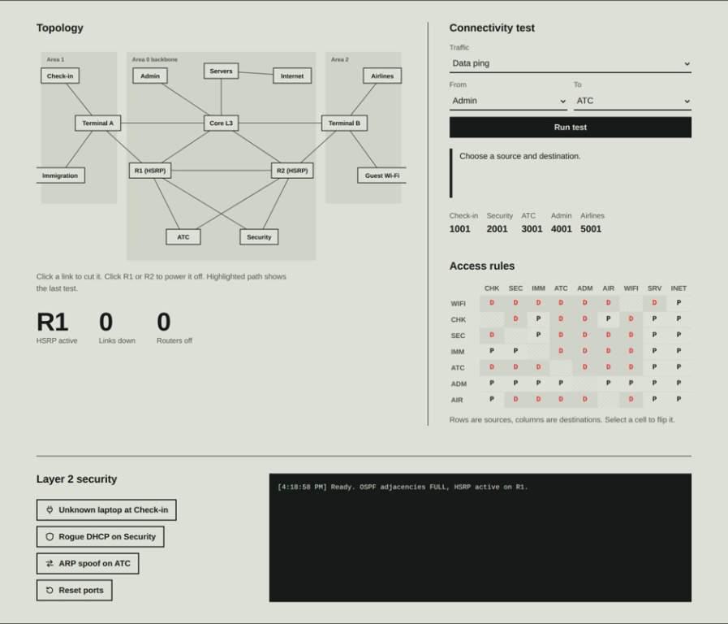
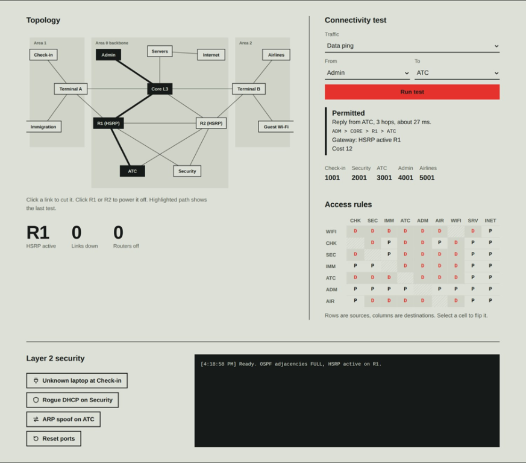
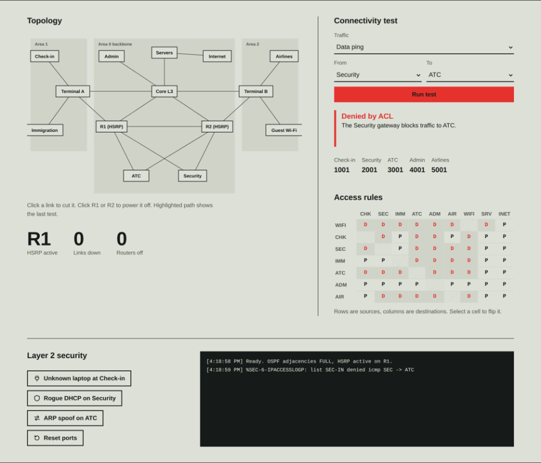
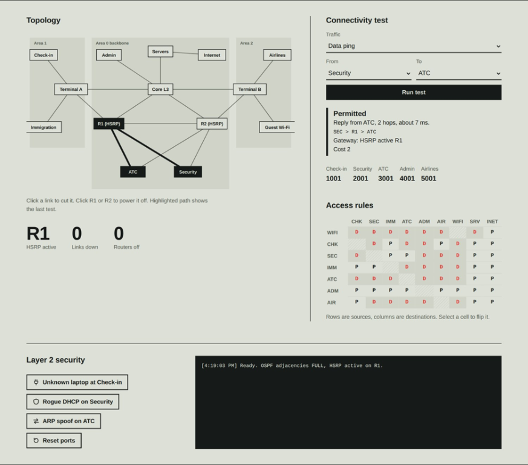
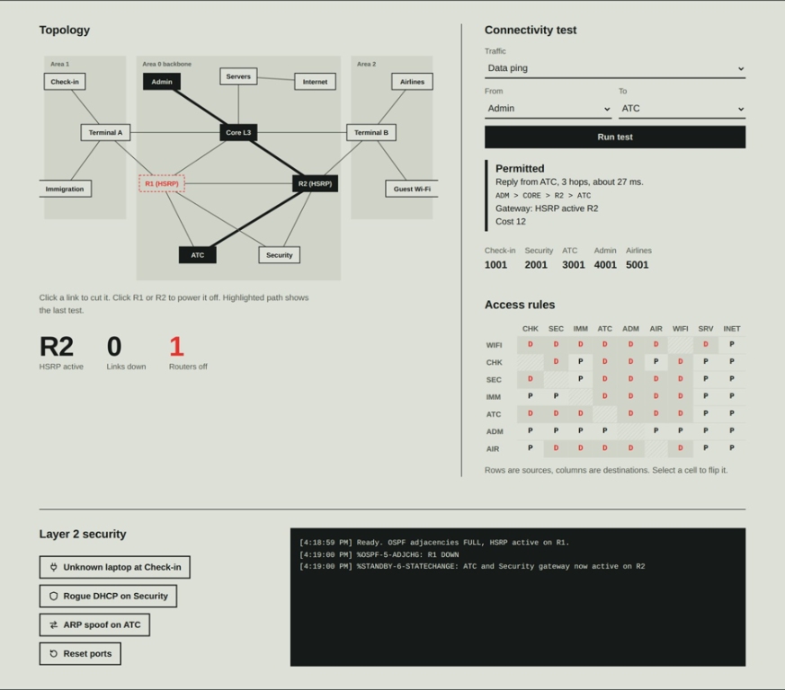
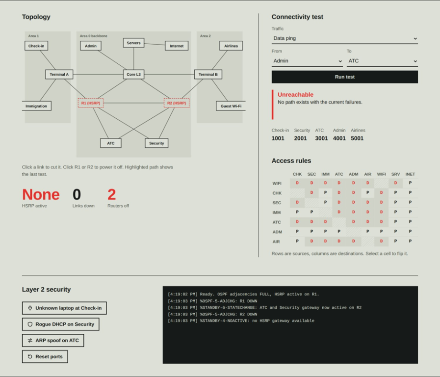
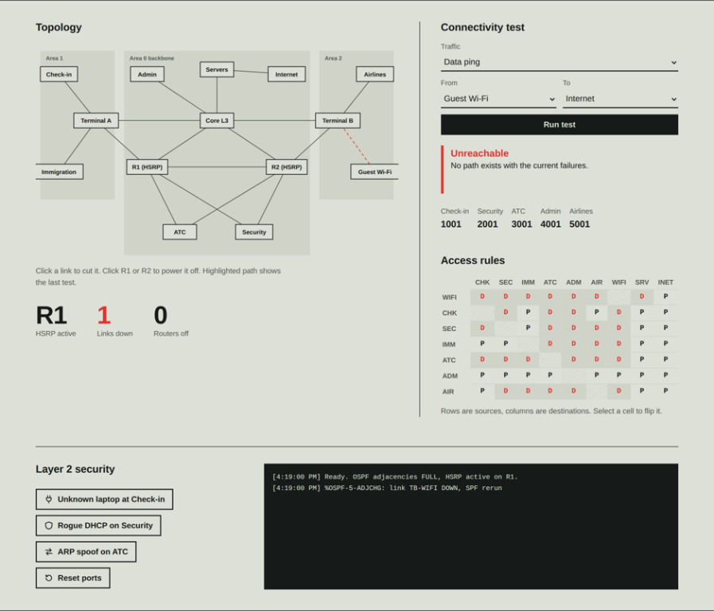
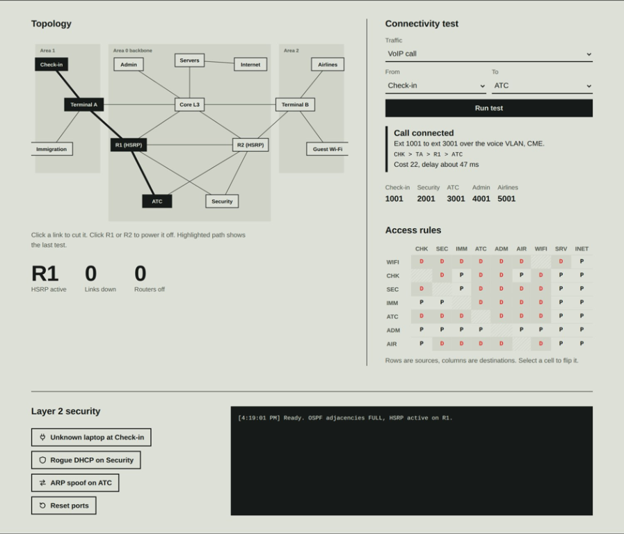
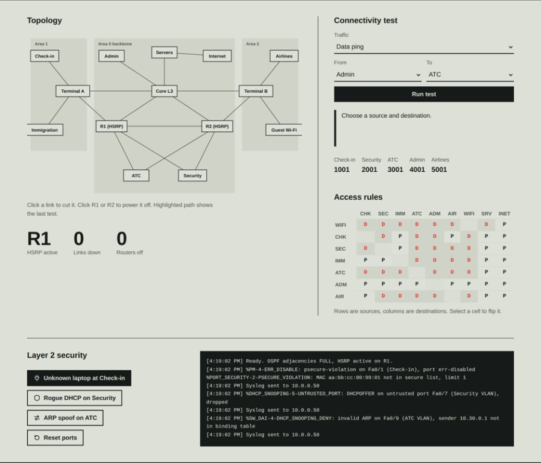

# Airport Communication Network

## Team members

- **ARIKTA DAS** - 24BCE2303
- **KHUSHI VERMA** - 24BCE2269
- **RITAMVARAA SINHA** - 22BDS0320

## Description 

An interactive, browser-based model of an airport communication network. The
project demonstrates how operational departments can be connected through a
segmented topology, how access policies affect communication, and how routing
paths change when links or gateway routers fail.

The simulation is designed as an educational visualization: network behavior
is modeled in client-side JavaScript and displayed in the browser. It does not
configure or control physical network equipment.

## Project overview

The modeled airport includes seven operational zones: Check-in, Security,
Immigration, Air Traffic Control (ATC), Administration, Airlines, and guest
Wi-Fi. The topology also includes terminals, a Layer 3 core, two gateway
routers, shared servers, and an internet node.

The interface provides an interactive topology map, connectivity and voice
tests, an editable access-control matrix, network status indicators, and an
event log. Users can explore how traffic policies and network failures affect
connectivity without needing a separate network simulator.

## Features and networking concepts

### Segmented network topology

- Department and guest zones are represented as distinct network nodes.
- The guest Wi-Fi policy permits access only to the modeled Internet node.
- Terminal links connect endpoint zones to the core and gateway routers.
- The diagram groups modeled links into OSPF-style areas: Area 0 and two
  terminal areas.

### Access-control policies

- A source-to-destination matrix shows whether data traffic is permitted or
  denied between modeled zones.
- Select a matrix cell to change that policy during a session.
- A denied data test is recorded in the on-page event log.

### Weighted path selection and link failures

- Each topology link has a cost. The JavaScript routing model uses Dijkstra's
  shortest-path algorithm to select a lowest-cost available path.
- Select a link on the map to mark it down or restore it. Connectivity tests
  then use the updated topology and display the selected path and cost.
- The shortest-path calculation is an educational model inspired by
  link-state routing; it is not an OSPF protocol implementation.

### Gateway redundancy model

- ATC and Security are modeled as high-availability zones connected to two
  routers.
- Router R1 is the preferred active gateway while it is available; R2 becomes
  active when R1 is turned off.
- Select either router on the topology map to change its state and observe
  gateway selection and route availability.
- This illustrates the HSRP gateway-redundancy concept without implementing
  the HSRP protocol.

### VoIP call-path demonstration

- Check-in, Security, ATC, Administration, and Airlines have sample phone
  extensions.
- Select VoIP call as the traffic type to test a call path between zones with
  modeled phones.
- The interface reports the extensions, route, and an illustrative delay.
  Call setup and voice transmission are not implemented.

### Layer 2 security event examples

- The security controls append sample log messages for a port-security
  violation, an untrusted DHCP offer, and an invalid ARP event.
- These examples introduce port security, DHCP snooping, and Dynamic ARP
  Inspection (DAI) concepts.
- Events are illustrative log entries; no DHCP service, switch-port
  enforcement, ARP inspection, or remote Syslog server is running.

## Technology stack

- **HTML5** — page structure, form controls, and accessible interface
- **CSS3** — responsive layout, typography, controls, and visual states
- **JavaScript (ES6+)** — topology data, access policies, shortest-path
  calculation, gateway selection, interactions, and event logging
- **SVG** — dynamically rendered, interactive network topology
- **Python 3 standard library** — optional local static HTTP server
- **Google Fonts** — Bricolage Grotesque and IBM Plex families, with system
  font fallbacks

The browser application has no package installation or build step. The Python
server is only used to serve the static website locally; the modeled network
logic runs in the browser.

## Run locally

1. Open the project folder in a terminal or in VS Code.
2. Start the local web server:

   ```powershell
   python serve.py
   ```

   If your system uses `python3`, run `python3 serve.py`. To use another port,
   pass it as an argument, for example `python serve.py 9000`.
3. Open [http://localhost:8000](http://localhost:8000) if your browser does
   not open automatically.
4. Press `Ctrl+C` in the terminal to stop the server.

You can also serve `index.html` with a static web server such as VS Code Live
Server. Google Fonts require an internet connection; local fallback fonts are
used when they are unavailable.

## Suggested walkthrough

1. Run the default Administration-to-ATC data test and inspect the displayed
   route.
2. Try a Security-to-ATC data test to see the default access policy deny it.
3. Change the corresponding access-control cell and run the test again.
4. Turn off R1 and observe the modeled active gateway switch to R2.
5. Disable a topology link and test connectivity again to observe path
   recalculation or an unreachable result.
6. Try a VoIP call between zones with sample phone extensions.
7. Trigger the Layer 2 security controls and review their illustrative log
   messages.

## Screenshots

The following figures show the simulator states in sequence:

### Figure 1: Initial state

OSPF adjacencies are full, R1 is the active gateway and the log shows the
ready message.



### Figure 2: Permitted data test

Admin to ATC follows ADM > CORE > R1 > ATC with cost 12 and the path
highlighted.



### Figure 3: Policy denial

Security to ATC is blocked by the access rules and the denial is logged.



### Figure 4: Policy edit

After the SEC>ATC cell is flipped to permit, the same test succeeds with cost
2.



### Figure 5: Gateway failover

R1 is off, R2 becomes the active gateway and the path moves to R2.



### Figure 6: Total gateway failure

R1 and R2 are both off, no gateway is active and ATC is unreachable.



### Figure 7: Link failure

The TB - WIFI link is cut and the Guest Wi-Fi to Internet test is
unreachable.



### Figure 8: VoIP call test

Check-in extension 1001 reaches ATC extension 3001 with cost 22.



### Figure 9: Layer 2 security examples

Port-security, DHCP-snooping and ARP-inspection messages in the syslog
console.



## Project structure

```text
.
├── .vscode/
│   └── launch.json
├── screenshots/
│   ├── 01-initial-state.png
│   ├── 02-permitted-admin-to-atc.png
│   ├── 03-security-atc-denied.png
│   ├── 04-security-atc-permitted.png
│   ├── 05-gateway-failover-to-r2.png
│   ├── 06-total-gateway-failure.png
│   ├── 07-guest-wifi-link-failure.png
│   ├── 08-voip-check-in-to-atc.png
│   └── 09-layer-2-security-events.png
├── static/
│   ├── app.js
│   └── style.css
├── index.html
├── README.md
└── serve.py
```
